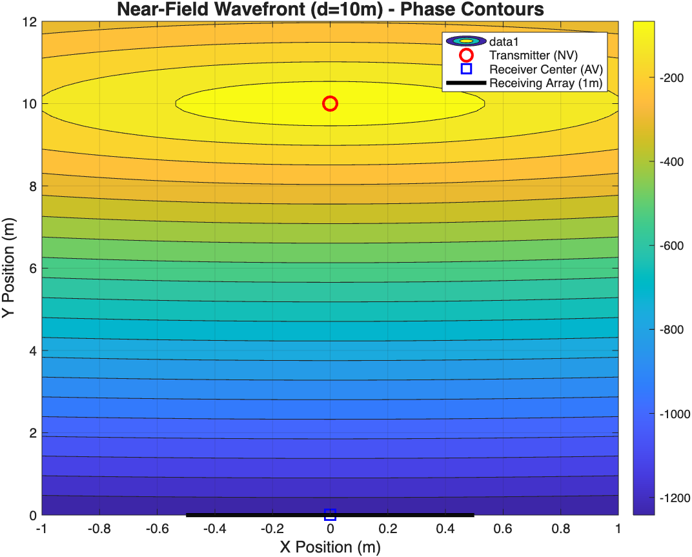
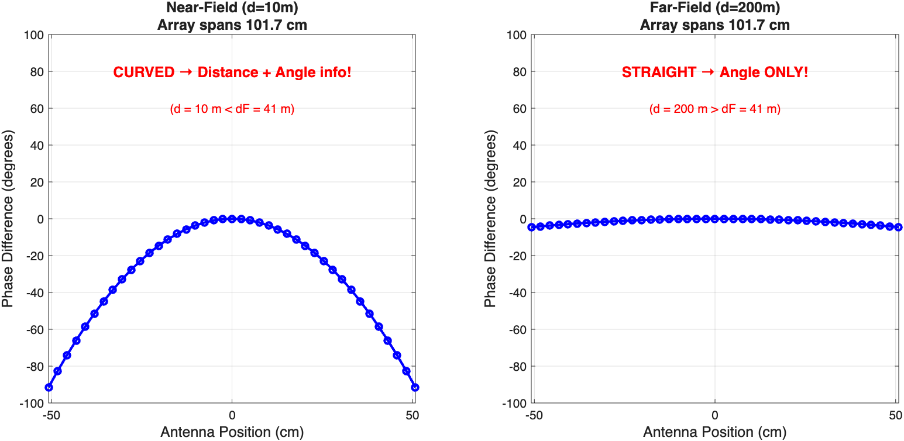
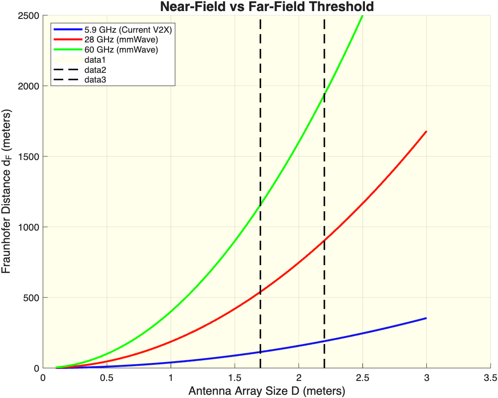
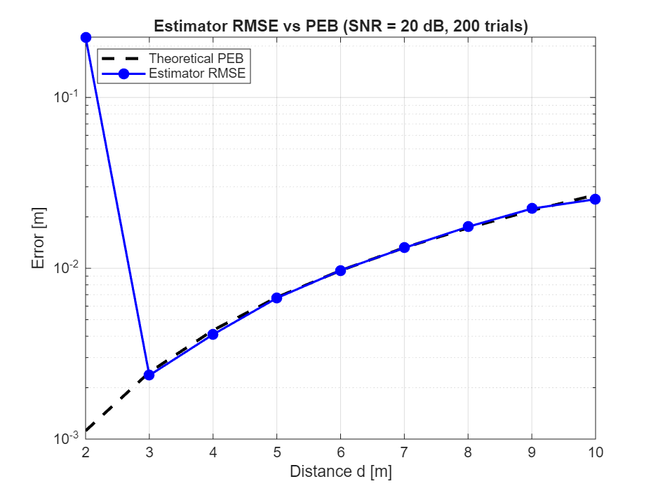
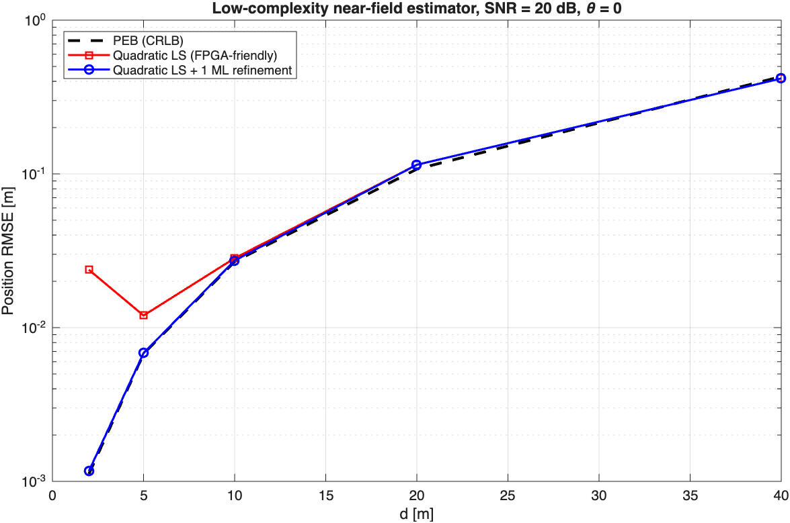
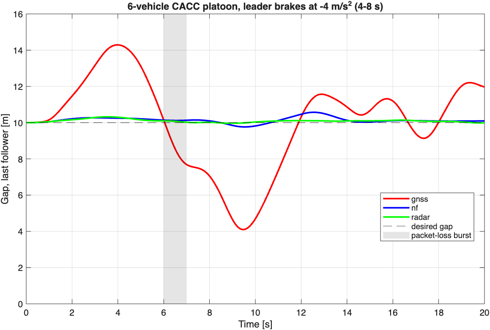

# V2X: Near-Field Localization and Vehicle Platoon Digital Twin

A MATLAB-based research project exploring **near-field localization for Vehicle-to-Everything (V2X) communication**, phase-based position estimation using antenna arrays, and its application to Cooperative Adaptive Cruise Control (CACC) through vehicle-platoon digital-twin simulations.

The project investigates how near-field antenna-array measurements can improve vehicle localization and how localization accuracy translates into vehicle-following and platoon stability performance.

## Project Overview

The project is organized around three interconnected areas:

### 1. Near-Field V2X Localization

- Modelling spherical wavefront propagation in the radiative near-field region.
- Generating differential phase measurements across a uniform linear antenna array.
- Incorporating phase noise based on communication SNR, pilot symbols, and subcarriers.
- Estimating vehicle position in terms of distance and angular orientation.
- Implementing grid-search maximum likelihood (ML) estimation with local optimization.
- Evaluating theoretical localization performance using the Position Error Bound (PEB).

### 2. Low-Complexity Position Estimation

Exploration of computationally efficient alternatives to conventional maximum likelihood estimation.

- Quadratic phase approximation for near-field localization.
- Least-squares estimation of angular position and distance.
- ML refinement of the quadratic estimator.
- Monte Carlo simulations to evaluate estimation accuracy.
- Comparison of estimator RMSE against the theoretical Position Error Bound.

### 3. Digital Twin of the Receive Array

A software twin of each vehicle's antenna array that runs on the live packet stream.

- Learns each element's hidden phase bias (Kalman filter) from the packets themselves.
- Chi-square health test on every fit; locates and masks a faulty element by leave-one-out.
- Predicts its own accuracy bound (PEB) for every fix.
- Shows a fundamental limit: from the packets alone, the bias component that looks like a change of angle and range (a linear plus quadratic phase profile across the array) is unobservable. Fixing it needs an external reference.

### 4. Vehicle Platoon Digital Twin

Integration of near-field localization into a multi-vehicle Cooperative Adaptive Cruise Control (CACC) simulation.

The digital twin compares three positioning approaches:

- **GNSS:** Position measurements with correlated localization errors.
- **Near-Field (NF):** Sidelink-based gap estimation using near-field localization accuracy.
- **Radar:** Gap and relative-velocity measurements.

The simulation incorporates:
- Multi-vehicle platoon dynamics.
- CACC control with proportional-derivative feedback.
- Actuator dynamics and communication latency.
- Periodic communication packets and packet-loss scenarios.
- Monte Carlo evaluation of platoon performance.
- Inter-vehicle gap tracking and string-error analysis.

## Repository Structure

```text
V2X/
│
├── FraunhoferDistance.m
├── nearfieldBounds.m
│
├── PhaseMeasurements.m
├── GridSearch.m
├── quadphase_estimator.m
├── monte_carlo_estimator.m
│
├── WavefrontVisualization.m
├── test_localization.m
├── validate_fig2.m
├── validate_fig6.m
│
├── platoon_digital_twin.m
├── platoon_twin_v2.m
├── platoon_twin_v3.m
│
├── nf_phase.m
├── nf_fit.m
├── nf_coarse.m
├── twin_init.m
├── twin_step.m
├── array_twin_demo.m
│
├── Figure_pdt.png
├── wavefront.png
├── phase_array.png
├── near_vs_far_field.png
├── fig2_matlab.png
├── fig6_matlab.png
├── rmse_vs_peb.png
├── quadphase_rmse_peb.png
└── platoon_v2.png
```

## Implementation Details

| File | Description |
|---|---|
| `FraunhoferDistance.m` | Computes the Fraunhofer distance for antenna-array analysis. |
| `nearfieldBounds.m` | Evaluates theoretical near-field localization bounds. |
| `PhaseMeasurements.m` | Generates noisy differential phase measurements. |
| `GridSearch.m` | Implements grid-search ML position estimation with local refinement. |
| `quadphase_estimator.m` | Implements low-complexity quadratic phase-based localization. |
| `monte_carlo_estimator.m` | Evaluates localization RMSE against theoretical PEB using Monte Carlo trials. |
| `WavefrontVisualization.m` | Visualizes antenna-array wavefront propagation. |
| `test_localization.m` | Tests the localization implementation. |
| `validate_fig2.m` | Validation script for Figure 2. |
| `validate_fig6.m` | Validation script for Figure 6. |
| `platoon_digital_twin.m` | Initial vehicle-platoon digital-twin implementation. |
| `platoon_twin_v2.m` | Extended six-vehicle CACC simulation with localization comparisons and packet-loss scenarios. |
| `nf_phase.m` | Near-field differential phase model (shared helper). |
| `nf_fit.m` | Fast Levenberg-Marquardt position fit with analytic Jacobian and correlated-noise whitening; runs once per packet. |
| `nf_coarse.m` | Starting point for `nf_fit` when no previous estimate exists. |
| `twin_init.m`, `twin_step.m` | Digital twin of one receive array: bias learning, health test, fault masking. |
| `array_twin_demo.m` | Standalone twin study: one array, 120 s packet stream, phase bias, drift, an element fault, reference beacons. |
| `platoon_twin_v3.m` | Closed loop: a twin in every follower, radar outage, antenna fault, radar-aided calibration, Monte Carlo, live view. |

## Simulation Parameters

The near-field localization implementation uses the following representative configuration:

| Parameter | Value |
|---|---:|
| Carrier frequency | 5.9 GHz |
| Antenna elements | 41 |
| Antenna spacing | λ/2 |
| Pilot OFDM symbols | 2 |
| Pilot subcarriers | 120 |
| Implementation loss | 6 dB |
| Reference SNR | 20 dB |

The simulation parameters can be modified within the respective MATLAB scripts.

## Results and Visualizations

### Near-Field Wavefront Propagation

Visualizing the spherical wavefront characteristics and the difference between near-field and far-field propagation.



### Antenna Array and Phase Measurements

Visualization of the antenna-array configuration and phase measurements used for position estimation.



### Near-Field vs Far-Field



### Localization Accuracy

Comparison of estimator RMSE against the theoretical Position Error Bound.



### Quadratic Phase Estimator

Performance comparison between the low-complexity quadratic least-squares estimator, its ML-refined version, and the theoretical bound.



### Vehicle Platoon Digital Twin

Simulation of a multi-vehicle CACC platoon comparing GNSS, near-field localization, and radar-based positioning approaches.



## Getting Started

### Requirements

- MATLAB R2019b or newer (uses `xline`/`yline`, `sgtitle`, local functions in scripts, implicit expansion).
- No toolboxes are needed. The twin computes the chi-square threshold as `2*gammaincinv(p, k/2)` instead of `chi2inv`.
- All project `.m` files available in the same working directory or on the MATLAB path.

### Running the Simulations

1. Clone the repository:

   ```bash
   git clone https://github.com/Reyansh-B/V2X.git
   ```

2. Navigate to the project directory:

   ```bash
   cd V2X
   ```

3. Open MATLAB and set the project directory as the current working directory.

4. Run the relevant scripts individually:

   ```matlab
   PhaseMeasurements
   ```

   ```matlab
   monte_carlo_estimator
   ```

   ```matlab
   quadphase_estimator
   ```

   ```matlab
   platoon_twin_v2
   ```

   ```matlab
   array_twin_demo
   ```

   ```matlab
   platoon_twin_v3
   ```

**Note:** Run the scripts individually rather than executing the entire directory at once. The platoon simulation depends on `nearfieldBounds.m`, which must be accessible on the MATLAB path.

## Digital Twin Results

`array_twin_demo` runs one array for 120 s with a 3° rms phase bias per element, drift, and a +60° fault on element 11 at 70 s. Four receivers see the same data: raw, twin with self-calibration, twin with a reference beacon every 10 s, and an oracle that knows the true bias.

`platoon_twin_v3` runs a leader and 5 followers for 60 s. The scenario has two brakings, a radar outage from 30 to 55 s, and the antenna fault on vehicle 3 at 45 s, during the outage. All cases share the same random world for each seed.

Expected results, from a Python reference run of the same algorithm (5 worlds). "Error" is the spacing error caused by the gap sensor, measured against the perfect-array case:

| Case | Normal | Radar outage | Faulty link | Min gap |
|---|---:|---:|---:|---:|
| Radar, dead reckoning in outage | 3.7 cm | 1.10 m | 1.35 m | 7.55 m |
| Radar + GNSS fallback | 3.7 cm | 1.23 m | 0.96 m | 6.78 m |
| NF, no twin | 16 cm | 18 cm | 24 cm | 9.50 m |
| NF + twin | 16 cm | 17 cm | 13 cm | 9.50 m |
| **NF + twin + radar-aided calibration** | **4.6 cm** | **4.5 cm** | **5.1 cm** | 9.50 m |

The twin flagged the fault within about 0.3 s and identified element 11 in all 5 worlds, with no false alarms. Your MATLAB numbers will differ slightly because MATLAB draws different random numbers.

Three findings stand out:

- **Self-calibration alone does not reduce position error.** The bias component that looks like a change of position is unobservable from the packets.
- **Radar-aided calibration fixes it without roadside infrastructure.** The twin calibrates against the radar while it works and carries that calibration through the outage.
- **In normal conditions radar is just as good.** The value of near-field ranging here is resilience when the radar fails.

Sensor parameters marked `PLACEHOLDER` in the scripts are assumptions, not datasheet values.

## Research Focus

This project explores the intersection of:

- Vehicle-to-Everything (V2X) communication.
- Near-field antenna-array localization.
- Spherical wavefront modelling.
- Statistical signal processing and parameter estimation.
- Cooperative Adaptive Cruise Control.
- Communication-aware vehicle platoon control.
- Digital-twin-based performance evaluation.
