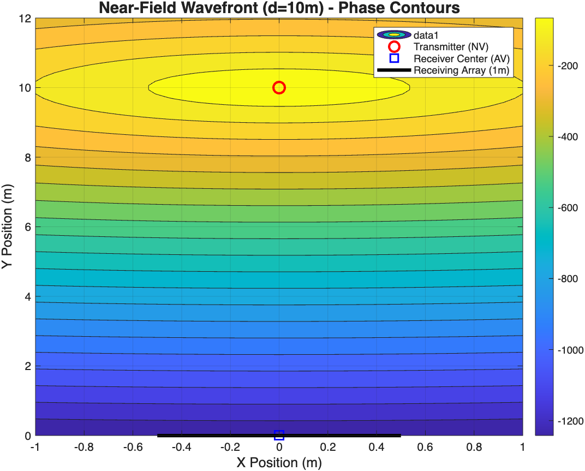
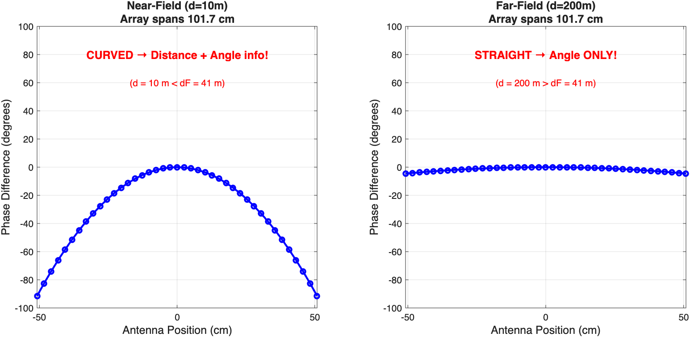
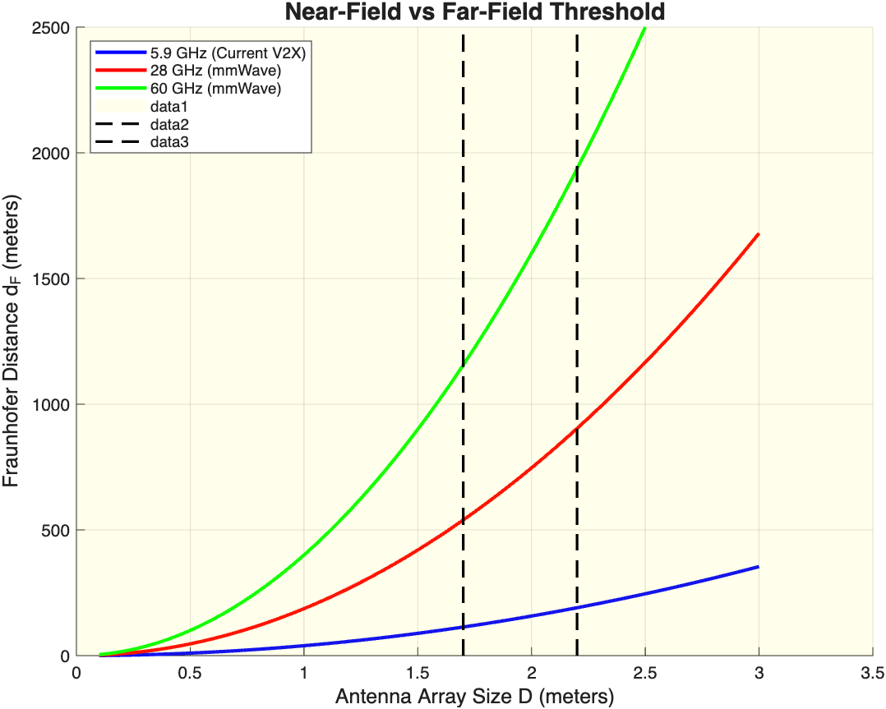
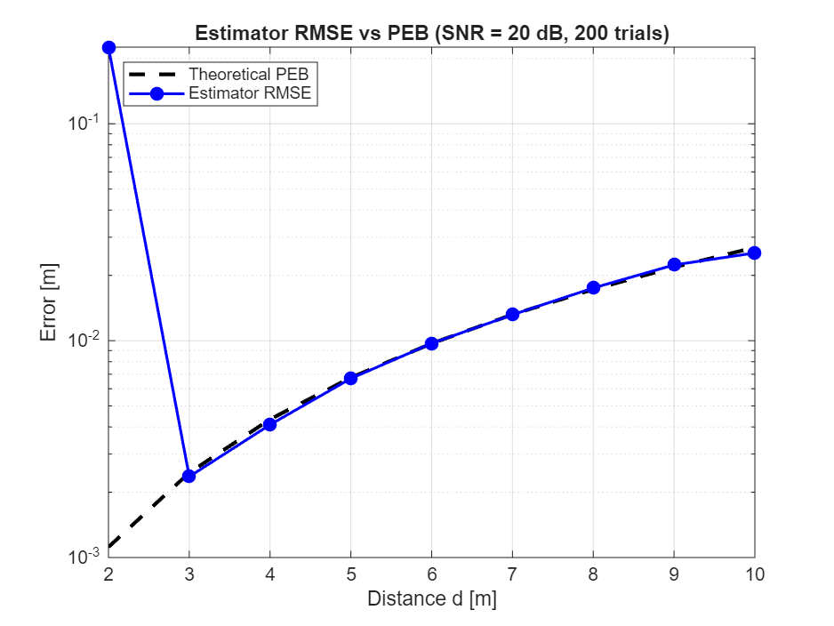
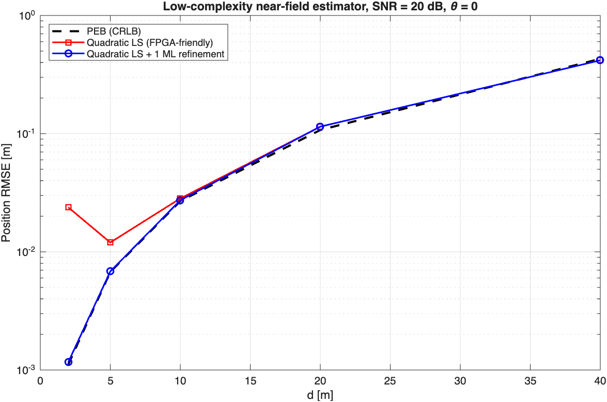
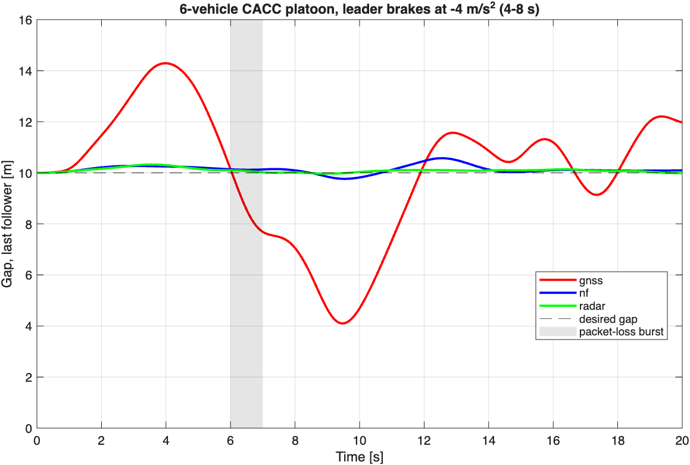

# V2X: Near-Field Localization and Vehicle Platoon Digital Twin

A MATLAB-based research project exploring **near-field localization for Vehicle-to-Everything (V2X) communication**, phase-based position estimation using antenna arrays, and its application to Cooperative Adaptive Cruise Control (CACC) through vehicle-platoon digital-twin simulations.

The project investigates how near-field antenna-array measurements can improve vehicle localization and how localization accuracy translates into vehicle-following and platoon stability performance.

## Project Overview

The project is organized around three interconnected areas:

### 1. Near-Field V2X Localization

- Modelling spherical wavefront propagation in the radiative near-field region.
- Generating differential phase measurements across a uniform linear antenna array.
- Incorporating phase noise based on communication SNR, pilot symbols, and subcarriers.
- Estimating vehicle position in terms of distance and angular orientation.
- Implementing grid-search maximum likelihood (ML) estimation with local optimization.
- Evaluating theoretical localization performance using the Position Error Bound (PEB).

### 2. Low-Complexity Position Estimation

Exploration of computationally efficient alternatives to conventional maximum likelihood estimation.

- Quadratic phase approximation for near-field localization.
- Least-squares estimation of angular position and distance.
- ML refinement of the quadratic estimator.
- Monte Carlo simulations to evaluate estimation accuracy.
- Comparison of estimator RMSE against the theoretical Position Error Bound.

### 3. Vehicle Platoon Digital Twin

Integration of near-field localization into a multi-vehicle Cooperative Adaptive Cruise Control (CACC) simulation.

The digital twin compares three positioning approaches:

- **GNSS:** Position measurements with correlated localization errors.
- **Near-Field (NF):** Sidelink-based gap estimation using near-field localization accuracy.
- **Radar:** Gap and relative-velocity measurements.

The simulation incorporates:
- Multi-vehicle platoon dynamics.
- CACC control with proportional-derivative feedback.
- Actuator dynamics and communication latency.
- Periodic communication packets and packet-loss scenarios.
- Monte Carlo evaluation of platoon performance.
- Inter-vehicle gap tracking and string-error analysis.

## Repository Structure

```text
V2X/
│
├── FraunhoferDistance.m
├── nearfieldBounds.m
│
├── PhaseMeasurements.m
├── GribSearch.m
├── quadphase_estimator.m
├── monte_carlo_estimator.m
│
├── WavefrontVisualization.m
├── test_localization.m
├── validate_fig2.m
├── validate_fig6.m
│
├── platoon_digital_twin.m
├── platoon_twin_v2.m
│
├── Figure_pdt.png
├── wavefront.png
├── phase_array.png
├── near_vs_far_field.png
├── fig2_matlab.png
├── fig6_matlab.png
├── rmse_vs_peb.png
├── quadphase_rmse_peb.png
└── platoon_v2.png
```

## Implementation Details

| File | Description |
|---|---|
| `FraunhoferDistance.m` | Computes the Fraunhofer distance for antenna-array analysis. |
| `nearfieldBounds.m` | Evaluates theoretical near-field localization bounds. |
| `PhaseMeasurements.m` | Generates noisy differential phase measurements. |
| `GribSearch.m` | Implements grid-search ML position estimation with local refinement (`GridSearch`). |
| `quadphase_estimator.m` | Implements low-complexity quadratic phase-based localization. |
| `monte_carlo_estimator.m` | Evaluates localization RMSE against theoretical PEB using Monte Carlo trials. |
| `WavefrontVisualization.m` | Visualizes antenna-array wavefront propagation. |
| `test_localization.m` | Tests the localization implementation. |
| `validate_fig2.m` | Validation script for Figure 2. |
| `validate_fig6.m` | Validation script for Figure 6. |
| `platoon_digital_twin.m` | Initial vehicle-platoon digital-twin implementation. |
| `platoon_twin_v2.m` | Extended six-vehicle CACC simulation with localization comparisons and packet-loss scenarios. |

## Simulation Parameters

The near-field localization implementation uses the following representative configuration:

| Parameter | Value |
|---|---:|
| Carrier frequency | 5.9 GHz |
| Antenna elements | 41 |
| Antenna spacing | λ/2 |
| Pilot OFDM symbols | 2 |
| Pilot subcarriers | 120 |
| Implementation loss | 6 dB |
| Reference SNR | 20 dB |

The simulation parameters can be modified within the respective MATLAB scripts.

## Results and Visualizations

### Near-Field Wavefront Propagation

Visualizing the spherical wavefront characteristics and the difference between near-field and far-field propagation.



### Antenna Array and Phase Measurements

Visualization of the antenna-array configuration and phase measurements used for position estimation.



### Near-Field vs Far-Field



### Localization Accuracy

Comparison of estimator RMSE against the theoretical Position Error Bound.



### Quadratic Phase Estimator

Performance comparison between the low-complexity quadratic least-squares estimator, its ML-refined version, and the theoretical bound.



### Vehicle Platoon Digital Twin

Simulation of a multi-vehicle CACC platoon comparing GNSS, near-field localization, and radar-based positioning approaches.



## Getting Started

### Requirements

- MATLAB
- MATLAB Optimization and numerical computation functions used by the scripts (the core implementation uses standard MATLAB functions).
- All project `.m` files available in the same working directory or on the MATLAB path.

### Running the Simulations

1. Clone the repository:

   ```bash
   git clone https://github.com/Reyansh-B/V2X.git
   ```

2. Navigate to the project directory:

   ```bash
   cd V2X
   ```

3. Open MATLAB and set the project directory as the current working directory.

4. Run the relevant scripts individually:

   ```matlab
   PhaseMeasurements
   ```

   ```matlab
   monte_carlo_estimator
   ```

   ```matlab
   quadphase_estimator
   ```

   ```matlab
   platoon_twin_v2
   ```

**Note:** Run the scripts individually rather than executing the entire directory at once. The platoon simulation depends on `nearfieldBounds.m`, which must be accessible on the MATLAB path.

## Research Focus

This project explores the intersection of:

- Vehicle-to-Everything (V2X) communication.
- Near-field antenna-array localization.
- Spherical wavefront modelling.
- Statistical signal processing and parameter estimation.
- Cooperative Adaptive Cruise Control.
- Communication-aware vehicle platoon control.
- Digital-twin-based performance evaluation.
